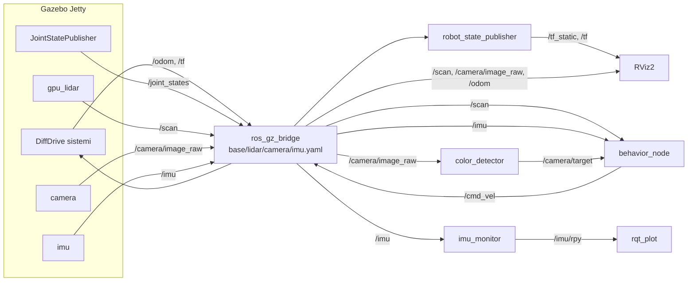
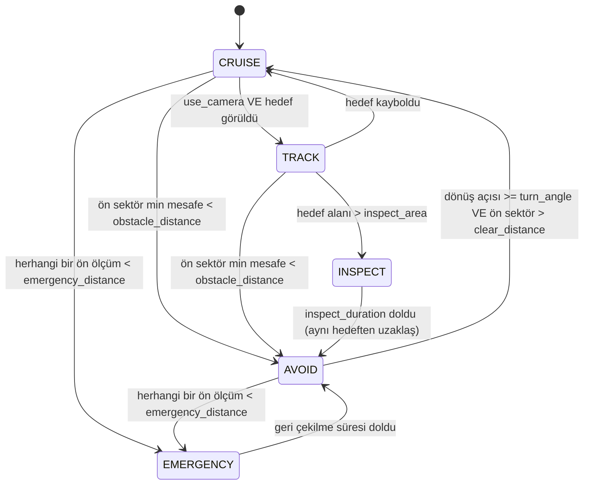

# Mimari

## 1. Senaryo

SeraBot, bir seradaki bitki sıraları arasında otonom dolaşan bir denetim robotudur.

- **Görev:** Sıralar arasındaki koridorlarda dolaşmak, saksı/duvar gibi engellerden kaçmak, kamera ile olgun (kırmızı) ürünü fark edip ona yönelmek.
- **Sürüş:** Diferansiyel sürüş — 2 arka tahrikli tekerlek + önde serbest caster. Dar koridorlarda yerinde dönebilmesi için seçildi.
- **Sensör yerleşimi:**
  - LiDAR şasinin üst-önünde; 360° tarama, koridor duvarları ve saksılar bu düzlemde görülür.
  - Kamera arka taraftaki direğin tepesinde, bitki/ürün yüksekliğinde ileri bakar.
  - IMU dönme merkezinde (tekerlek aksının ortası); dönüş açısı ve hareket ölçümü.

Boyutlar ve montaj pozisyonları: [INTERFACES.md §4](INTERFACES.md#4-robot-boyutları-ve-montaj-noktaları)

## 2. Paketler

```
src/
├── serabot_description/   ament_cmake — URDF/Xacro, meshes, model kontrol launch'ı
├── serabot_gazebo/        ament_cmake — sera dünyası (SDF), primitif modeller
├── serabot_bringup/       ament_cmake — tek launch dosyası, ros_gz_bridge yaml'ları, RViz config
├── serabot_sensors/       ament_python — sensör yardımcı node'ları (renk dedektörü, IMU izleme vb.)
└── serabot_behavior/      ament_python — davranış node'u + saf karar mantığı + testler
```

| Paket | İçerik | Bağımlılıklar (ana) |
|---|---|---|
| `serabot_description` | `urdf/serabot.urdf.xacro` (ana), `properties.xacro`, `chassis.xacro`, `wheels.xacro`, `gazebo_drive.xacro`, `sensors/*.xacro`, `launch/display.launch.py`, `rviz/model.rviz` | `xacro`, `robot_state_publisher`, `joint_state_publisher_gui`, `rviz2` |
| `serabot_gazebo` | `worlds/greenhouse.sdf`, `models/` | `ros_gz_sim` |
| `serabot_bringup` | `launch/bringup.launch.py`, `config/bridge/{base,lidar,camera,imu}.yaml`, `config/behavior.yaml`, `rviz/serabot.rviz` | `serabot_description`, `serabot_gazebo`, `ros_gz_sim`, `ros_gz_bridge`, `rviz2` |
| `serabot_sensors` | `color_detector` (kamera), `imu_monitor` (IMU) | `rclpy`, `sensor_msgs`, `cv_bridge`, `opencv` |
| `serabot_behavior` | `logic.py` (saf durum makinesi), `behavior_node.py`, `test/` | `rclpy`, `sensor_msgs`, `geometry_msgs` |

## 3. Veri akışı



Tüm topic ve mesaj tipleri: [INTERFACES.md](INTERFACES.md)

## 4. TF ağacı

```
odom                       (DiffDrive, bridge üzerinden /tf)
└── base_footprint         (zemin seviyesi, robot merkezi)
    └── base_link          (tekerlek aksının ortası = dönme merkezi)
        ├── left_wheel_link    (continuous)
        ├── right_wheel_link   (continuous)
        ├── caster_link        (fixed)
        ├── lidar_link         (fixed)
        ├── imu_link           (fixed)
        └── camera_mast_link   (fixed)
            └── camera_link        (fixed)
                └── camera_optical_link (fixed, REP-103 optik eksen)
```

`odom → base_footprint` Gazebo DiffDrive'dan gelir; geri kalanı `robot_state_publisher` (`/joint_states` + URDF) tarafından yayınlanır. `map` frame'i yoktur (navigasyon/SLAM kapsam dışı).

## 5. Launch yapısı

`ros2 launch serabot_bringup bringup.launch.py` sırasıyla:

1. `ros_gz_sim` ile `greenhouse.sdf` dünyasını açar.
2. Xacro'yu işleyip `robot_state_publisher`'ı başlatır (`robot_description`).
3. `ros_gz_sim create` ile robotu `robot_description`'dan spawn eder.
4. `config/bridge/*.yaml` dosyalarının her biri için ayrı bir `parameter_bridge` node'u başlatır (sensör sahipleri birbirinin dosyasına dokunmaz).
5. RViz2'yi `rviz/serabot.rviz` ile açar.
6. İsteğe bağlı: `behavior:=true` ise davranış node'unu, `sensors:=true` ise yardımcı sensör node'larını başlatır.

Argümanlar ve varsayılanlar: [INTERFACES.md §6](INTERFACES.md#6-launch-argümanları)

## 6. Davranış node'u (taslak)

Giriş: `/scan` (zorunlu), `/imu` (dönüş açısı), `/camera/target` (opsiyonel). Çıkış: `/cmd_vel`. Döngü: 10 Hz zamanlayıcı.



- **CRUISE:** sabit ileri hız.
- **AVOID:** daha açık olan tarafa (sol/sağ sektör ortalamasına göre) yerinde dön; dönülen açı IMU açısal hızının integrali ile ölçülür.
- **TRACK** (opsiyonel katman): `angular.z = -k · offset`, yavaş ileri hız.
- **INSPECT:** dur, `inspect_duration` saniye bekle (ürün "denetleniyor").
- **EMERGENCY:** dur ve kısa süre geri git.

Çekirdek (zorunlu) davranış: CRUISE + AVOID + EMERGENCY — sadece LiDAR ve IMU'ya bağlıdır. Kamera katmanı (TRACK/INSPECT) `use_camera` parametresiyle açılır; kamera modülü hazır olmasa da demo çalışır.

Kesin karar kuralı ve parametreler: [modules/behavior.md](modules/behavior.md)

## 7. Doğrulama stratejisi

| Seviye | Ne | Nerede |
|---|---|---|
| Statik | Python sözdizimi, xacro → URDF, saf mantık pytest | Windows (yerel) |
| Derleme | `colcon build`, `colcon test` | GitHub Actions CI (`ros:lyrical`) — F0'da kurulacak |
| Simülasyon | Gazebo'da hareket, sensör verisi, davranış | Linux makine (WSL2/VM/Üye B) — en geç 30 Ekim |
