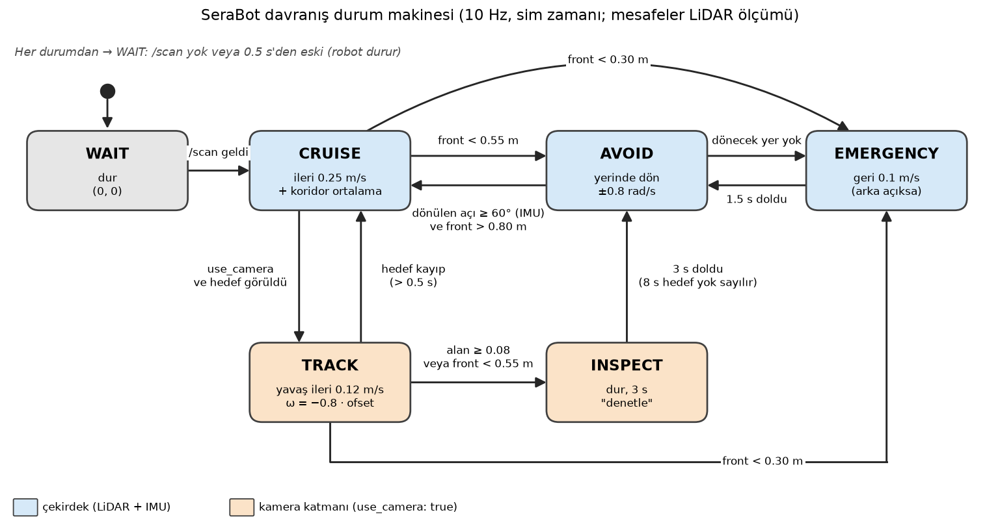

# SeraBot davranış node'u — durum diyagramı, karar kuralı, topic'ler

Rapor ve sunum (canlı demo) için. Kaynak kod: `src/serabot_behavior/serabot_behavior/logic.py` (karar mantığı, ROS'suz) ve `behavior_node.py` (ROS bağlantısı). Varsayılan değerler: `src/serabot_bringup/config/behavior.yaml`. Doğrulama durumu: [docs/modules/behavior.md](../../modules/behavior.md).

## 1. Genel yapı

```
/scan ──► analyze_scan() ──► ScanSummary ─┐
/imu  ──► YawIntegrator (dönülen açı) ─────┼─► BehaviorStateMachine.update()  (10 Hz, sim zamanı)
/camera/target ──► son hedef ──────────────┘          │
                                                      ├─► /cmd_vel        (Twist)
                                                      └─► /behavior/state (String)
```

- `behavior_node` sadece abone olur, yayınlar ve parametre okur; her karar `logic.py` içindeki saf Python sınıfında verilir. Bu sınıf ROS'suz pytest ile test edilir (26 test).
- Döngü 10 Hz, **sim zamanıyla** çalışır (`use_sim_time: true`). VM'deki gerçek zaman oranı ≈ 0.5 olsa da süreler ve dönüş açıları doğru kalır.

## 2. Giriş ve çıkış topic'leri

| Yön | Topic | Mesaj tipi | Kullanılan alanlar | QoS | Ne için |
|---|---|---|---|---|---|
| Giriş | `/scan` | `sensor_msgs/msg/LaserScan` | `ranges`, `angle_min`, `angle_increment`, `range_min`, `range_max`, `header.stamp` | sensor data (best effort) | Engel mesafeleri: ön, sol, sağ, arka, dönüş için yer |
| Giriş | `/imu` | `sensor_msgs/msg/Imu` | `angular_velocity.z`, `header.stamp` | sensor data | Yerinde dönüşte dönülen açı (açısal hızın integrali) |
| Giriş (opsiyonel) | `/camera/target` | `geometry_msgs/msg/PointStamped` | `point.x` = yatay ofset [−1, 1] (sol negatif), `point.y` = görüntü alanı oranı [0, 1], `header.stamp` | sensor data | Kırmızı ürüne yönelme; sadece `use_camera: true` iken abone olunur |
| Giriş (dolaylı) | `/clock` | `rosgraph_msgs/msg/Clock` | — | — | Sim zamanı (`use_sim_time`) |
| Çıkış | `/cmd_vel` | `geometry_msgs/msg/Twist` | `linear.x` [m/s], `angular.z` [rad/s] | reliable, 10 | Diferansiyel sürüş komutu (Gazebo DiffDrive) |
| Çıkış | `/behavior/state` | `std_msgs/msg/String` | `data` = durum adı | reliable, 10 | Aktif durum (sunum, hata ayıklama, kayıt) |

Her durum değişiminde node gerekçesini log'a yazar, örneğin:

```
[behavior_node]: CRUISE -> AVOID: front 0.55 m < 0.55 m; turning right
[behavior_node]: AVOID -> CRUISE: turned 176 deg (imu), front 0.98 m
```

## 3. Taramadan çıkarılan mesafeler

LiDAR, `base_link`'in (tekerlek aksının ortası, dönme merkezi) 0.22 m önündedir. Her ölçüm `base_link`'e taşınır: `x = 0.22 + r·cos θ`, `y = r·sin θ`.

| Büyüklük | Tanım |
|---|---|
| Temizlik | `nan`, `−inf` ve `range_min` (0.25 m) altı atılır; `+inf` "engel yok" = `range_max` (8 m) sayılır; gövde kutusu içine düşen noktalar (kendi gövdesi) atılır |
| `front_min` | Ön sektör (±30°) **veya** gövde koridoru (robot genişliği 0.52 m + 2×0.05 m, gövdenin önü) içindeki en yakın ölçüm. Koridor kontrolü, sektörün kaçırdığı yakın yan engelleri yakalar |
| `left_mean` / `right_mean` | 30°–100° sol / sağ sektörlerin ortalama mesafesi → dönüş yönü seçimi |
| `left_min` / `right_min` | Aynı sektörlerin en küçük mesafesi → koridorda ortalama |
| `rear_gap` | Şasi arkası ile arkadaki en yakın nokta arası → geri gitmek güvenli mi |
| `rotate_clear_left/right` | O yöne yerinde dönerken gövdenin süpürdüğü daireye (yarıçap 0.376 m = `base_link`'ten en uzak ön köşe) kalan boşluk |

## 4. Durum diyagramı



```mermaid
stateDiagram-v2
  [*] --> WAIT
  WAIT --> CRUISE: /scan geldi
  CRUISE --> EMERGENCY: front_min < 0.30 m
  CRUISE --> AVOID: front_min < 0.55 m
  CRUISE --> TRACK: use_camera ve hedef görüldü
  AVOID --> CRUISE: dönülen açı >= 60° ve front_min > 0.80 m
  AVOID --> EMERGENCY: dönecek yer kalmadı
  EMERGENCY --> AVOID: 1.5 s doldu
  TRACK --> EMERGENCY: front_min < 0.30 m
  TRACK --> CRUISE: hedef kayboldu (> 0.5 s)
  TRACK --> INSPECT: alan >= 0.08 veya front_min < 0.55 m
  INSPECT --> AVOID: 3 s doldu (8 s hedef yok sayılır)
  note right of WAIT: Her durumdan → WAIT: /scan yok veya 0.5 s'den eski (dur)
```

- **Çekirdek** (zorunlu, LiDAR + IMU): WAIT, CRUISE, AVOID, EMERGENCY.
- **Kamera katmanı** (opsiyonel, `use_camera: true`): TRACK, INSPECT. Kamera hazır olmasa da çekirdek çalışır.

## 5. Karar kuralı tablosu

Her 10 Hz adımda aktif durumun satırındaki koşullar **yukarıdan aşağıya** denetlenir; ilk sağlanan koşul uygulanır. Hiçbiri sağlanmazsa durumun komutu yayınlanır.

| Durum | Komut (`linear.x`, `angular.z`) | Koşul → yeni durum (öncelik sırasıyla) |
|---|---|---|
| **(her durum)** | — | `/scan` yok veya 0.5 s'den eski → **WAIT** |
| **WAIT** | 0, 0 | Taze `/scan` → **CRUISE** |
| **CRUISE** | 0.25 m/s, ortalama: 0.5·(sol_min − sağ_min) (±0.3 rad/s, yan mesafeler 1 m'de kırpılır) | 1. `front_min < 0.30` → **EMERGENCY**<br>2. `front_min < 0.55` → **AVOID**<br>3. `use_camera` ve taze hedef (0.5 s) ve bekleme süresi dışında → **TRACK** |
| **AVOID** | 0, ±0.8 rad/s (yerinde dönüş) | Girişte yön seçimi: dönüş yeri olan (boşluk ≥ 0.02 m) taraflardan ortalama mesafesi büyük olan; dönüş boyunca kilitli. İki tarafta da yer yoksa → **EMERGENCY**<br>1. Seçilen yönde boşluk < 0.02 m → **EMERGENCY**<br>2. Dönülen açı ≥ 60° **ve** `front_min > 0.80` → **CRUISE** |
| **EMERGENCY** | −0.1 m/s (arkada > 0.15 m boşluk varsa, yoksa 0), 0 | 1.5 s doldu → **AVOID** (yön yeniden seçilir) |
| **TRACK** | 0.12 m/s, −0.8·ofset (±0.8 rad/s) | 1. `front_min < 0.30` → **EMERGENCY**<br>2. Hedef 0.5 s'dir yok → **CRUISE**<br>3. Hedef alanı ≥ 0.08 → **INSPECT**<br>4. `front_min < 0.55` (hedefin bulunduğu yatağa varıldı) → **INSPECT** |
| **INSPECT** | 0, 0 (ürün "denetleniyor") | 3 s doldu → **AVOID**; sonraki 8 s hedefler yok sayılır (aynı ürüne tekrar kilitlenmemek için) |

**Dönülen açının ölçümü:** IMU'nun `angular_velocity.z` değeri mesaj zaman damgalarıyla integre edilir (100 Hz). IMU 0.3 s'den uzun süre gelmezse o adımda yedek kullanılır: açı += 0.8 rad/s × Δt. Log'daki `(imu)` / `(time)` etiketi hangisinin kullanıldığını gösterir.

**İşaret kuralları:** `angular.z > 0` sola (saat yönü tersine) dönüş. Hedef ofseti solda negatif olduğundan `angular.z = −k·ofset` robotu hedefe çevirir. Ortalama terimi, sol taraf daha açıksa pozitiftir (sola, yani ortaya doğru).

**Neden bu eşikler:**
- `0.55 m` (LiDAR'dan) = gövde önünden 0.425 m, dönme merkezinden 0.77 m > 0.376 m dönüş yarıçapı → durduğu yerde dönebilir.
- `0.80 m` çıkış eşiği, 0.55 ile arasındaki histerezis sayesinde AVOID ↔ CRUISE titreşimini önler.
- `0.30 m` acil eşiği dönme merkezinden ≈ 0.52 m'dir; bu yüzden AVOID sırasında acil duruma geçilmez (dönmek hâlâ güvenli). EMERGENCY sadece ileri giderken veya dönecek yer yokken devreye girer.

## 6. Parametreler (`config/behavior.yaml`)

| Parametre | Varsayılan | Kullanım |
|---|---|---|
| `forward_speed` | 0.25 m/s | CRUISE ileri hızı |
| `turn_speed` | 0.8 rad/s | AVOID yerinde dönüş hızı, zaman tabanlı yedek |
| `front_sector_deg` | 30° | Ön sektör yarım açısı |
| `obstacle_distance` | 0.55 m | CRUISE → AVOID |
| `clear_distance` | 0.80 m | AVOID → CRUISE |
| `emergency_distance` | 0.30 m | → EMERGENCY |
| `turn_angle_deg` | 60° | AVOID'de en az dönüş |
| `rotate_margin` | 0.02 m | Dönüş dairesi etrafında gereken boşluk |
| `backup_speed` / `backup_duration` | 0.1 m/s / 1.5 s | EMERGENCY geri çekilme |
| `centering_gain` | 0.5 | Koridorda ortalama (0 = kapalı) |
| `use_camera` | false | TRACK / INSPECT katmanı |
| `inspect_area` / `inspect_duration` | 0.08 / 3 s | INSPECT |
| `track_gain` / `track_speed` | 0.8 / 0.12 m/s | TRACK |
| `control_rate` | 10 Hz | Karar döngüsü |

Tam liste ve açıklamaları: `behavior.yaml`.

## 7. Canlı demo için

```bash
ros2 launch serabot_bringup bringup.launch.py behavior:=true
ros2 topic echo /behavior/state
ros2 topic echo /cmd_vel
ros2 topic hz /scan
rqt_graph
```

Anlatım sırası: (1) `rqt_graph`'ta `/scan`, `/imu` → `behavior_node` → `/cmd_vel`; (2) mesaj tipleri (tablo §2); (3) robot duvara yaklaşırken `/behavior/state` CRUISE → AVOID, `/cmd_vel` `linear.x` 0.25 → 0, `angular.z` 0 → ±0.8; (4) dönüş IMU ile ölçülüp 60° ve önü açık olunca tekrar CRUISE (log satırı).

## 8. Test sonucu (özet)

VM'de (Docker, Lyrical + Jetty) varsayılan spawn noktasından 180 s sim zamanı: çarpışma yok, gövde ile engeller arası en küçük mesafe 0.106 m, 37.1 m yol, 16 AVOID, 0 EMERGENCY ([run3_trajectory.png](run3_trajectory.png), [run3_transitions.log](run3_transitions.log)). Tek koşu; kamera katmanı Gazebo'da denenmedi.
